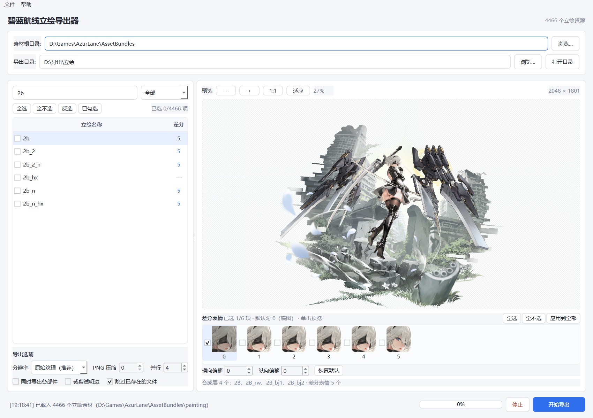
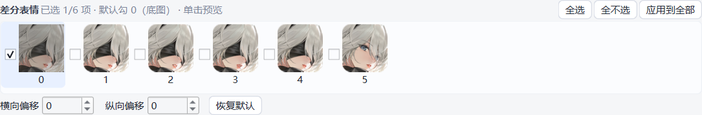

# 碧蓝航线立绘导出器（三合一）

把原本需要 **AssetStudioMod → AzurLanePaintingExtract → AzurLanePaintingAnalysis-Kt** 三个软件、五六步手工操作的流程，合并成一个可以直接运行的 Windows 程序。

程序直接读取游戏的 `AssetBundles`，自动完成：

1. 解析 AssetBundle（相当于 AssetStudioMod 里筛选 Mesh / Texture2D 并导出）；
2. 用网格把贴图还原成图片（相当于 AzurLanePaintingExtract）；
3. 按游戏内的 UI 布局把多个部件合成完整立绘，并把 `paintingface` 里的差分表情合成到脸上（相当于 ALPA）。

最终每个立绘输出一张完整 PNG；差分表情可以像 ALPA 一样先看列表、再勾选要导出的那几个。



## 功能特性

- **一步到位**：选好 `AssetBundles` 和输出目录，勾选立绘即可批量导出，不需要任何中间文件夹。
- **完整立绘**：自动合并背景、人物、舰装等多层 MeshImage，按游戏内布局定位。
- **差分表情自选**：`0` = 无表情底图，`1/2/3…` = 对应表情，可多选、可预览、可一键应用到全部立绘。
- **表情偏移微调**：横向/纵向偏移，支持输入与上下箭头，方向与 ALPA 一致（右/上为正）。
- **预览可缩放**：滚轮缩放、拖动平移、`1:1` / `适应窗口`。
- **断点续跑**：按“本次应产出的文件”逐个判断，缺哪个补哪个，已存在的文件不覆盖。
- **两种输出尺寸**：默认按游戏布局（`2b` = 4299×3779，人物层 1:1）；需要素材原生像素时切到「原始纹理」（`2b` = 2048×1800）。
- **绿色免安装**：打包版自带 Python / Qt / VC 运行库，解压双击即用。

## 快速开始（使用打包版）

1. 解压整个文件夹到任意位置。
2. 双击 `AzurLanePaintingExport.exe`。
3. **素材根目录** 选择游戏的 `AssetBundles` 文件夹（例如 `D:\AzurLane\AssetBundles`），该目录下应能看到 `painting`、`paintingface`、`dependencies`。
4. **导出目录** 选择保存位置。
5. 在左侧列表勾选立绘，点 **开始导出**。

> 第一次打开时两个路径都是空白的，需要自己选择；选好之后程序会记住，下次启动自动填入。

## 素材目录说明（AssetBundles）

游戏 `AssetBundles` 是整个资源库（当前版本约 23 GB、60 多个顶层目录），导出静态立绘只用到其中 5 项：

| 路径 | 规模 | 用途 |
| --- | --- | --- |
| `AssetBundles\painting\` | 10679 个 / 7.6 GB | 每个立绘一个 prefab bundle（**无后缀**）+ 它的贴图 bundle（**`_tex` 结尾**）。程序只扫这里取立绘清单 |
| `AssetBundles\paintingface\` | 2247 个 / 715 MB | 差分表情 Sprite 组，覆盖率约一半立绘 |
| `AssetBundles\dependencies` | 1 个 / 6.5 MB | bundle→依赖 映射表（约 8.7 万条）。缺了它，prefab 的 Sprite/Texture 指针全部解析不到 |
| `AssetBundles\custom_builtin` | 1 个 / 24 MB | 内置 shader/材质共享 bundle，几乎所有立绘 prefab 都声明依赖 |
| `AssetBundles\ui\commonui_atlas` | 1 个 / 388 KB | UI 图集，少数立绘（如 `2b_2`、`a2_2`）的装饰图层放在这里，**漏了会少图层且不报错** |

合计约 8.35 GB。可以只保留这 5 项使用；直接指向完整的 `AssetBundles` 也完全没问题。

**属于静态立绘**：`painting\<名字>`（基础名 / `_数字` 皮肤 / `_n` 无装备 / `_hx` 换装，都是独立作品）、它的 `*_tex` 图层、`paintingface\<名字>`。

**与静态立绘无关**：`spinepainting`（Spine 动画图集）、`live2d` / `live2dmask`、`char`（角色小图与头像）、`metapainting`、`shoppainting`、`painting_filte`，以及 `bg` / `scenes` / `effect` / `ui`（除上面那一个图集）等其余目录。`paintings` / `buildpainting` / `guildpainting` / `feastpainting` / `commanderpainting` / `activitypainting` 在当前版本是空目录。

> `painting\` 里有极少数文件名既不带 `_tex` 也不是立绘 prefab（`mat`、`mat_v1f1`、`haifeng_3_n_rw`、`dafeng_6_shophx`，全量 4466 个里占 4 个），程序会跳过并在日志里提示。

## 从源码运行

需要 64 位 Python 3.11+（Windows 10/11）。

```bat
python -m venv .venv
.venv\Scripts\activate
pip install -r requirements.txt
python 源码\main.py
```

也可以双击 `源码\run.bat`（会调用系统里的 `python`）。

跑一遍自检（不需要游戏素材，验证布局合成 / 表情合成 / 导出调度）：

```bat
python 源码\selftest.py
```

## 使用说明

### 差分表情



- 选中立绘后，右侧列出 `0、1、2、3…` 的缩略图，数字即 ALPA 里看到的表达式编号。
- **`0` 号 = 无表情底图**：点 0 预览原画，勾 0 就导出 `2b.png`。
- **默认只勾 0**：默认导出一张原画底图；想看/导出表情时再勾 `1、2、3…`。
- 勾选哪些就只导出哪些；一个都不勾时按“底图”处理。
- **应用到全部**：把当前勾选套用到所有立绘（例如只勾 3 号）。
- 没有对应表情的立绘会自动跳过表情部分，不会报错。

### 预览

- 滚轮缩放，按住左键拖动平移。
- 顶部 `− / + / 1:1 / 适应`，双击在 1:1 与适应窗口之间切换。
- 预览区越大，看表情细节越方便。

### 表情偏移

- 缩略图下方有 **横向偏移 / 纵向偏移**，可直接输入数字，也可点上下箭头逐格调整。
- 方向与 ALPA 一致：横向正数向右，纵向正数向上。
- **恢复默认** 把当前立绘的偏移归零；偏移按立绘分别记忆，预览与导出同时生效。

### 筛选与勾选

- 搜索框支持名称关键字，例如 `hailunna`、`_rw`、`2b`。
- 过滤器：`全部` / `仅含差分表情` / `仅 _rw` / `仅 _n` / `排除背景部件`。
- `全选 / 全不选 / 反选 / 已勾选`：`已勾选` 只显示当前勾选的立绘，方便导出前核对。
- 右上角显示 `已选 x/y 项`。

### 输出结构

所有文件放在以立绘名命名的子文件夹中：

```
导出目录/
├─ 2b/
│  ├─ 2b.png                 无表情底图（勾选 0 号时导出）
│  ├─ 2b_1.png               带 1 号差分表情的完整立绘
│  ├─ 2b_2.png
│  ├─ …
│  └─ parts/                 （勾选“同时导出各部件”时才有）
│     ├─ 2B.png
│     ├─ 2B_rw.png
│     └─ …
└─ hailunna/
   ├─ hailunna_1.png
   └─ …
```

> `parts/` 里是各图层按网格还原后的原始尺寸；合成图按上面的「分辨率」选项输出，两者尺寸不一定相同。
> 同一立绘里出现同名图层时会自动加序号，例如 `2B.png`、`2B_2.png`，不会互相覆盖。

**关于人物层的分辨率**：合成图按 prefab 的 UI 布局摆放图层，`_rw` 人物层的纹理往往比它在画面里占的尺寸大
（`2b` 的 `_rw` 纹理 1774×2048，在 2048 宽的成品里只占 845 px），所以成品图中人物区是按布局比例合成的，
这一点与 ALPE / ALPA 的输出一致。若需要人物层的 1:1 原图，勾选「同时导出各部件」，
`parts\2B_rw.png` 就是 1774×2048 的原始尺寸，不含任何缩放。

### 导出选项

- **分辨率**（两项，选择会被记住）：
  - **`游戏布局`（默认）**：按 prefab 的 UI 坐标 1:1 输出，`2b` = 4299×3779。人物层保持 1:1，背景是 2048→4299 的上采样。
  - **`原始纹理`**：按素材原始纹理分辨率输出，如 `2b` = 2048×1800，与 ALPE 一致。
    不放大、不做整体缩放；图层与纹理尺寸一致时原样贴合，只有极少数布局要求缩放的图层（`_rw` 人物层，纹理 1774 px 而画面里占 845 px）才按布局比例重采样。

  实测对比（`2b`）：体积 3.2 MB → 10.9 MB（3.4×）；按原尺寸看两者几乎没差别（边缘能量 1.00×）；
  放大 3 倍看时，游戏布局版的人物区锐度是 1:1 版的 2.08×。
- **PNG 压缩**：0–9，默认 **0（不压缩，保存最快）**；需要更小体积可调到 6–9。
- **并行**：同时解析的进程数，默认一半 CPU 核心。
- **同时导出各部件**：额外导出每个图层。
- **裁剪透明边**：去掉四周透明区域。
- **跳过已存在的文件**：断点续跑，见下节。

### 断点续跑（跳过逻辑）

对每个立绘先算出“本次应该产出的文件”（`0` → `2b.png`，`1` → `2b_1.png`…），然后：

1. 全部已存在 → 跳过，连 bundle 都不打开；
2. 缺哪个补哪个 → 只打开一次，只写缺失的文件，已有文件不覆盖；
3. 该立绘没有的编号（根据缓存的表情名清单判断）→ 不触发解析，状态显示“无匹配表情”；
4. 勾选“同时导出各部件”时，还要求 `parts` 子目录里有 PNG 才算完成。

判断本身只是文件存在性检查，全量约 0.2 秒，主要耗时仍在真正需要补的立绘上。

## 命令行批处理（可选）

```bat
AzurLanePaintingExport.exe --cli ^
  --root "D:\AzurLane\AssetBundles" ^
  --out  "D:\导出\立绘" ^
  --workers 8
```

| 参数 | 说明 |
| --- | --- |
| `--name 2b` | 只导出指定立绘，可重复 |
| `--limit 50` | 最多导出多少个 |
| `--no-faces` | 不导出差分表情 |
| `--face-names 0,3` | 指定导出底图（0）和 3 号表情 |
| `--base` | 在全部表情之外额外导出底图 |
| `--parts` | 额外导出各部件 |
| `--ui-scale` | 按游戏布局尺寸输出（放大版，背景为上采样） |
| `--crop` | 裁剪透明边 |
| `--level 6` | PNG 压缩等级（默认 0） |

> 命令行不加 `--face-names` 时会导出该立绘的所有表情。
> 另有一个内部调试入口 `--diag --root <目录> --name 2b`，打印解析与预览结果，用于排查个别立绘。

## 工作原理

| 原工具 | 本程序的实现 |
| --- | --- |
| [AssetStudioMod](https://github.com/aelurum/AssetStudioMod) | `core.py` 的 `AssetSource` / `analyze()`：用 UnityPy 读取 SerializedFile，解析 GameObject / RectTransform / MonoBehaviour（`m_Sprite`、`mMesh`、`mRawSpriteSize`），取得顶点、UV、三角形与贴图 |
| [AzurLanePaintingExtract](https://github.com/azurlane-doujin/AzurLanePaintingExtract-v1.0) | `rebuild_part()`：按三角形 UV 包围盒裁剪贴图，再按网格坐标贴回画布（y 轴翻转与取整规则一致） |
| [AzurLanePaintingAnalysis-Kt](https://github.com/Deficuet/AzurLanePaintingAnalysis-Kt) | `ExtTransform`（移植其 RectTransform 坐标算法）、`fit()`、`compose_base()`、`load_faces()`、`compose_face()` |

差分文件匹配规则与 ALPA 一致：立绘名按 `_` 切分最多 3 段，取前两段并去掉 `_n`，作为 `paintingface/<名字>`。例如 `aogusite_4_n → paintingface/aogusite_4`。

## 项目结构

```
├─ AzurLanePaintingExport.exe   打包版主程序
├─ _internal/                   打包版运行时（Python / Qt / 依赖）
├─ 使用说明.txt                  给最终用户看的简版说明
├─ 源码/
│  ├─ main.py          GUI、预览、导出调度、命令行入口
│  ├─ core.py          AssetBundle 解析 / 网格还原 / 布局合成
│  ├─ worker.py        多进程任务入口（导出、预览）
│  ├─ selftest.py      离线自检（不需要游戏素材）
│  ├─ build.ps1        PyInstaller 打包脚本
│  ├─ make_icon.py     生成程序图标（打包前会用到，产物在 assets/）
│  └─ run.bat          从源码启动
├─ docs/               README 截图
├─ requirements.txt
└─ LICENSE
```

## 构建打包版

```powershell
pip install -r requirements.txt pyinstaller
cd 源码
.\build.ps1
```

如果提示「在此系统上禁止运行脚本」（PowerShell 执行策略为 Restricted），改用
`powershell -ExecutionPolicy Bypass -File .\build.ps1`，或在「设置 → 系统 → 开发者选项」里放开脚本执行。

生成结果在 `源码\dist\AzurLanePaintingExport\`（exe + `_internal`），把这两项一起拷到发布目录即可。
需要 Windows 64 位与 Python 3.11+；`build.ps1` 会在缺少 `assets\app.ico` 时自动调用 `make_icon.py` 生成图标。

## 常见问题

**1. 某些立绘导出失败 / 提示“该文件不是立绘 prefab”**
`painting` 目录里混有贴图 bundle（例如 `2b_rw`），它们没有 GameObject，无法单独成图，跳过即可。

**2. 导出图只有背景 / 只有舰装**
部分 prefab 的图层是给不同界面复用的，程序按 prefab 实际布局叠合；可用“同时导出各部件”自行取舍。

**3. 差分表情位置有偏移**
极少数老立绘依赖运行时脚本。程序按 RectTransform 计算，和 ALPA 一致；仍有个别偏差时可用偏移微调。

**4. 导出的图比游戏里看到的“小”**
输出是原生纹理尺寸（如 2048×1800），游戏里立绘被放大到 2 倍尺寸显示，所以看起来更大。这是 ALPE / ALPA 的通用尺寸，也是无缩放的原图。
极少数老立绘的 prefab 布局比纹理高（例如 `ninghai` 布局 1024、纹理 982），此时按布局输出，避免裁掉内容。

**5. 图上少了一两层装饰**
检查 `AssetBundles\ui\commonui_atlas` 是否还在。少数立绘（`2b_2`、`a2_2`）的装饰图层寄存在这个 UI 图集里，缺文件时不会报错，只会少图层。

**6. 内存占用高 / 速度慢**
每个立绘要解码 1–4 张 2048 级贴图。批量导出时把“并行”调到 4–6，8 GB 内存建议不超过 6。

**7. 杀毒软件报毒**
PyInstaller 打包的未签名 exe 常见误报，源码完全公开，可自行构建。

**8. 换电脑后路径被记住 / 想恢复默认**
路径保存在 `HKEY_CURRENT_USER\Software\AzurLaneTools\PaintingExporter`，删除该键即可恢复首次启动状态。

## 开源协议与致谢

本程序以 MIT 协议开源，见 [LICENSE](LICENSE)。

算法与思路来自以下三个 MIT 项目，在此致谢：

- [aelurum/AssetStudioMod](https://github.com/aelurum/AssetStudioMod) — AssetBundle / Mesh / Texture2D 解析
- [azurlane-doujin/AzurLanePaintingExtract-v1.0](https://github.com/azurlane-doujin/AzurLanePaintingExtract-v1.0) — 网格还原算法
- [Deficuet/AzurLanePaintingAnalysis-Kt](https://github.com/Deficuet/AzurLanePaintingAnalysis-Kt) — 布局分析与差分表情合成

依赖：[UnityPy](https://github.com/K0lb3/UnityPy)（MIT）、[Pillow](https://python-pillow.org/)（HPND）、[PySide6](https://www.qt.io/)（LGPLv3）。

游戏《碧蓝航线》的角色立绘、差分表情等素材版权归上海蛮啾网络科技 / 勇仕网络及原画作者所有。本程序不附带任何游戏素材，仅供个人学习与素材整理，请勿用于商业用途。

## 更新记录

- **v1.12.0**：
  - 修复差分表情取错 bundle 的问题：原来按「立绘名取前两段」推算表情包名，三段式名字会全部塌成同一个
    （`tiancheng_cv_2` / `tiancheng_cv_3` / `tiancheng_cv_h` 及其 `_n` 版本全都取了 `tiancheng_cv` 的表情，
    合成后脸是别人的、还会出现明显的矩形接缝）。
  - 现在优先用同名 bundle；`_n`（无装备）仍与本体共用表情；`_hx` 有独立表情组时用独立的那套。
    再往宽泛回退时（`_ex` / `_asmr` / `_wjz` 这类同图变体）会核对**表情槽尺寸**：对得上才沿用，
    对不上就不套用——宁可这张图没有表情，也不要贴错人的脸。
  - 表情数量缓存加了规则版本号，升级后会自动重算，不会继续显示旧结果。
  - 全量核对：4466 个立绘中 4272 个结果不变；74 个改用自己同名的表情包（原来取错）；110 个变体
    （`2b_hx`、`banjiu_ex` 等）补上了原本缺失的表情；10 个确认脸槽对不上的不再套用别人的表情。
- **v1.11.0**：
  - 分辨率默认改为「游戏布局」（`2b` = 4299×3779，人物层 1:1）；下拉文案去掉「（推荐）」「（更大）」，只留「原始纹理」「游戏布局」，可随时切换。默认值使用新的配置键，升级后不会被旧版存下的「原始纹理」覆盖；之后手动切换仍会被记住。命令行默认不变（`--cli` 仍输出原始纹理，加 `--ui-scale` 才是游戏布局）。
  - 画布尺寸吸附到原生纹理（`2b` 从 2048×1801 修正为 2048×1800）；图层尺寸与纹理差 ≤2px 时直接原样贴合，不再被重采样。预览取消降采样，`1:1` 就是真实像素。
  - 修复个别立绘合成错位（如 `i404`、`i404_n`：几个背景层被垫到错误的声明尺寸上再缩放，画面碎成几块）。现在只有当 `mRawSpriteSize` 与图层矩形的长宽比一致时才垫边，其余按网格图原样合成；其余立绘的输出逐像素不变。
  - 修复纵向表情偏移在导出时方向相反的问题（预览是向上、导出却向下，与 ALPA 的“上为正”不一致）。
  - 导出只解码需要用到的差分表情；去掉解析阶段重复的网格解压（每个立绘少跑一遍 MeshHandler）。
  - 超大立绘的预览按 400 万像素降采样后再回传，切换立绘不再因为几千万像素的 PNG 卡顿。
  - 选择到无效目录时立即清空素材列表并撤销该路径，不再出现“列表是旧的、导出全失败”。“跳过已存在文件”与“无匹配表情”在状态里分开显示。
  - 各部件导出遇到同名图层自动加序号；勾选“跳过已存在”时各部件也不再重复覆盖。
  - 源码目录整理：补 `requirements.txt` / `run.bat`，`build.ps1` 自动生成图标，新增 `selftest.py`，清理死代码。
  - 在完整游戏资源上验证：4466 个候选 prefab 扫描通过 4462 个，真实批量导出尺寸逐个核对。
- **v1.10.1**：修复在某些分割条位置预览图与缩放百分比持续跳动的问题（滚动条出现/隐藏改变了 viewport 尺寸，触发反复自适应）。
- **v1.10.0**：跳过逻辑改为“按需文件判断”，缺哪个补哪个；表情名字清单随数量一起缓存。
- **v1.9.0**：删除“合并差分表情”总开关（表情勾选已覆盖，0=底图）；导出选项并为两行。
- **v1.8.0**：表情列表新增 0 号（无表情底图），默认勾 0；`--face-names 0` 导出底图。
- **v1.7.0**：默认一个表情一张图，不再附带无表情底图（改为可选项）。
- **v1.6.0**：所有输出统一进“立绘名”子文件夹；压缩表情区与偏移行间距。
- **v1.5.0**：PNG 压缩默认 0；新增表情横/纵偏移微调。
- **v1.4.0**：日志移至底部状态栏；导出选项下移；差分列显示数量。
- **v1.3.0**：首次启动不预填目录；修复全选/已勾选切换问题。
- **v1.2.0**：表情默认只勾第一个；预览缩放；未勾选时导出当前预览。
- **v1.1.0**：新增差分表情自选。
- **v1.0.0**：三工具合并，一步导出完整立绘与差分表情。
